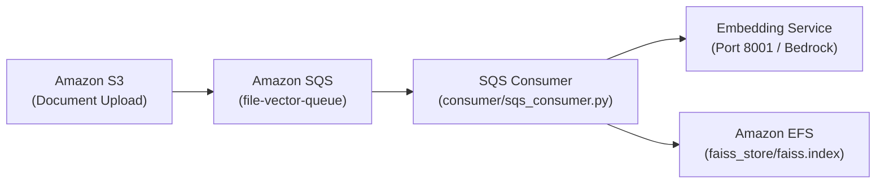

# SQS Consumer Worker Microservice

Independent worker service that listens to Amazon SQS for new document upload events, downloads files from S3, extracts text chunks, embeds them (via embedding-service or Bedrock), and updates the shared FAISS vector store on Amazon EFS.

---

## Architecture Flow



---

## Running Locally

Run [`consumer/run.bat`](file:///e:/AgenticApp/consumer/run.bat) or:
```powershell
cd E:\AgenticApp
$env:PYTHONPATH="E:\AgenticApp"
python -m consumer.sqs_consumer
```

---

## Building & Pushing to Amazon ECR

Run from the **project root directory** (`E:\AgenticApp`):

```bash
# 1. Login to AWS ECR
aws ecr get-login-password --region ap-southeast-2 | docker login --username AWS --password-stdin 377074487303.dkr.ecr.ap-southeast-2.amazonaws.com

# 2. Create the ECR repository (if not already created)
aws ecr create-repository --repository-name rag-chatbot-worker --region ap-southeast-2

# 3. Build the worker image
docker build -f consumer/Dockerfile -t rag-chatbot-worker:latest .

# 4. Tag and push to ECR
docker tag rag-chatbot-worker:latest 377074487303.dkr.ecr.ap-southeast-2.amazonaws.com/rag-chatbot-worker:latest
docker push 377074487303.dkr.ecr.ap-southeast-2.amazonaws.com/rag-chatbot-worker:latest
```

---

## ECS Deployment

This service is deployed as a continuous background Fargate task using:
[`infra/ecs/task-def-worker.json`](file:///e:/AgenticApp/infra/ecs/task-def-worker.json)

Key requirements on ECS:
- **EFS Mount**: Mounted to `/mnt/efs/faiss_store` with write permissions so the worker updates the shared vector store.
- **IAM Task Role**: Needs `sqs:ReceiveMessage`, `sqs:DeleteMessage`, `sqs:GetQueueUrl`, `s3:GetObject`.
